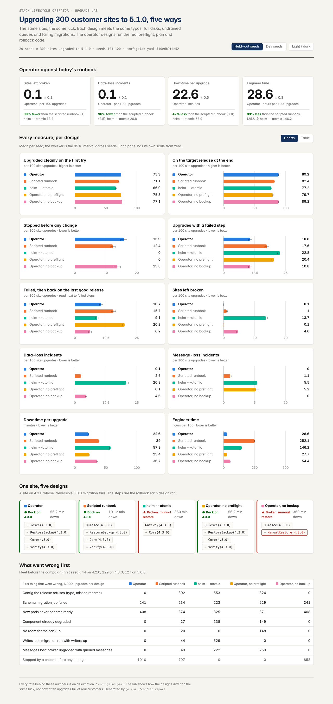

# stack-lifecycle-operator

A Kubernetes operator in Go that installs, upgrades and recovers a multi-service platform: PostgreSQL, RabbitMQ, a core service and an API gateway, as it would run on-premise at a customer site. It checks an upgrade before changing anything, backs up before migrations that cannot be reversed, rolls out one verified release at a time and rolls back on its own when a step fails. Python release tooling lints the rendered manifests against OpenShift's restricted SCC, gates AI-assisted changes and builds redacted support bundles.

An upgrade lab runs the real planning code against a simulated fleet of 300 sites and compares the operator with today's scripted runbook and with `helm upgrade --atomic`.



## Results

<!-- results:start -->
**heldout split** · 20 seeds × 300 sites upgraded to 5.1.0 · mean per seed ± 95% interval · settings `config/lab.yaml` (sha256 `f10edb9f4e52`)

| Per 100 site upgrades | Scripted runbook (today) | helm upgrade --atomic | Operator | Operator without preflight | Operator without backup |
|---|---:|---:|---:|---:|---:|
| Upgraded cleanly on the first try | 71.1 ± 1.2 | 66.9 ± 1.3 | **75.3 ± 1.1** | 75.3 ± 1.1 | 77.1 ± 1 |
| On the target release at the end | 82.4 ± 0.9 | 77.2 ± 1 | **89.2 ± 0.7** | 79.7 ± 1 | 89.2 ± 0.7 |
| Stopped before any change | 12.4 ± 0.8 | 0 ± 0 | **15.9 ± 1.1** | 0 ± 0 | 13.8 ± 1.1 |
| Upgrades with a failed step | 17.6 ± 0.9 | 22.8 ± 1 | **10.8 ± 0.7** | 20.4 ± 1 | 10.8 ± 0.7 |
| Failed, then back on the last good release | 15.7 ± 0.9 | 9.1 ± 0.7 | **10.7 ± 0.7** | 20.2 ± 0.9 | 6.2 ± 0.7 |
| Sites left broken | 1 ± 0.3 | 13.7 ± 0.6 | **0.1 ± 0.1** | 0.1 ± 0.1 | 4.6 ± 0.4 |
| Data-loss incidents | 2.5 ± 0.5 | 20.8 ± 0.9 | **0.1 ± 0.1** | 0.1 ± 0.1 | 4.6 ± 0.4 |
| Message-loss incidents | 1.1 ± 0.2 | 5.5 ± 0.6 | **0 ± 0** | 5.2 ± 0.5 | 0 ± 0 |
| Downtime per upgrade (minutes) | 39 ± 1.1 | 57.9 ± 2.2 | **22.6 ± 0.5** | 23.4 ± 0.6 | 36.7 ± 1.5 |
| Engineer time (hours per 100) | 252.1 ± 3 | 146.2 ± 4 | **28.6 ± 0.8** | 27.7 ± 0.9 | 54.4 ± 2.8 |
| Downtime, worst 5% of upgrades (minutes) | 136.9 | 375.5 | 35 | 66.6 | 53 |

The dev split (10 seeds) agrees: operator 0.2 data-loss and 0.2 broken sites per 100 against 2.5 and 1.3 for the scripted runbook.
<!-- results:end -->

The lab rates in `config/lab.yaml` are assumptions, not measurements. Full tables: [reports/RESULTS.md](reports/RESULTS.md). The dashboard is `dashboard/index.html`.

## What it does

```
kubectl apply -f platformstack.yaml          # spec.version: 4.3.0  -> installs
kubectl patch pstack site-frankfurt --type merge -p '{"spec":{"version":"5.1.0"}}'
```

1. **Preflight, no changes.** Path through supported releases (4.3.0 → 5.0.0 → 5.1.0; no skipping, no downgrades), config migrated and validated for every release on the path (renamed keys carried over, typos caught with a suggestion), all components healthy, room on the database volume for a backup, broker queues empty before a broker upgrade. A failed check leaves the phase `Blocked` with the reason in the `Ready` condition, and the upgrade starts by itself once the check passes.
2. **Plan in status.** One hop per release, each ending in Verify. Irreversible migrations get Backup and Quiesce (writers stopped) first.
3. **One step per reconcile.** Jobs with fixed names (`site-migrate-20`) run once (`backoffLimit: 0`); Deployments roll with `maxUnavailable: 0`; every step has a timeout.
4. **Rollback.** On failure, services go back to the last verified release first, then the schema is reversed (reversible hops) or restored from the backup (irreversible hops). If neither is possible, the operator stops with `ManualRestore` rather than guess. A rolled-back version is not retried until the spec changes.

```
$ kubectl get pstack
NAME             PHASE         INSTALLED   TARGET   SCHEMA
site-frankfurt   RollingBack   4.3.0       5.0.0    13
```

```yaml
status:
  phase: RollingBack
  rollbackTarget: 4.3.0
  steps:
  - {kind: Backup,        version: 5.0.0, schema: 13, state: Done}
  - {kind: Quiesce,       version: 5.0.0,             state: Done}
  - {kind: Migrate,       version: 5.0.0, schema: 20, state: Failed, message: "job site-migrate-20 failed: migration step 17 failed"}
  - {kind: Messaging,     version: 5.0.0,             state: Skipped}
  - {kind: Core,          version: 5.0.0,             state: Skipped}
  - {kind: Gateway,       version: 5.0.0,             state: Skipped}
  - {kind: Verify,        version: 5.0.0,             state: Skipped}
  - {kind: Quiesce,       version: 4.3.0,             state: Done}
  - {kind: RestoreBackup, version: 4.3.0, schema: 13, state: Running}
  - {kind: Core,          version: 4.3.0,             state: Pending}
  - {kind: Verify,        version: 4.3.0,             state: Pending}
```

## Layout

| Path | What |
|---|---|
| `api/v1alpha1` | `PlatformStack` CRD types: spec (version, config, storage, replicas, upgrade policy), status (phase, plan, history, conditions) |
| `internal/release` | Release catalog (`catalog.json`): upgrade edges, schema version, reversibility, config rules per release |
| `internal/plan` | Pure functions: config migration, preflight, plan, rollback. No Kubernetes types |
| `internal/render` | Restricted-v2 StatefulSets, Deployments, Services, ConfigMaps, Jobs |
| `internal/controller` | Reconciler: one step per pass, status, events, conditions |
| `internal/lab`, `cmd/lab` | Fleet simulation and generated reports |
| `cmd/render` | Prints the manifests for a `PlatformStack` for linting and review |
| `tools/stackctl` | Python: `openshift-lint`, `review-gate`, `support-bundle` |
| `config/` | CRD, Role (least privilege), manager Deployment, sample, lab and review-gate settings |
| `docs/` | ADRs, service-manager → Kubernetes mapping, screenshots |

## Security

- **OpenShift restricted-v2 / Pod Security "restricted"** for every pod: no fixed UID, `runAsNonRoot`, RuntimeDefault seccomp, all capabilities dropped, read-only root with an emptyDir for `/tmp`, no service-account token. Enforced by `internal/render` tests and `stackctl openshift-lint` on the rendered manifests in CI.
- **Least-privilege RBAC.** A namespaced Role. Secrets: `get` and `create` only, read uncached so the operator never lists them. `rbac_test.go` fails if the Role and the `+kubebuilder:rbac` markers drift.
- **Credentials** are random, created once, never logged and never overwritten.
- **Support bundles** redact Secret data, sensitive env values, URL credentials, bearer tokens, private keys, phone numbers, IMSIs and email addresses, and list every redaction in `REDACTIONS.json` so the customer can check before sending.
- **Operator image**: static binary on distroless `nonroot`, no shell.

## AI-assisted development

`AGENTS.md` holds the invariants a coding agent must keep; `ai/tasks/` has task templates with their done-checks. In CI, `stackctl review-gate` reads commit trailers: an AI-assisted change (`AI-Assisted: yes` or a `Co-Authored-By` naming an assistant) to a security-sensitive path (RBAC, CRD, controller, plan, render, workflows) needs a `Reviewed-by:` trailer from a named person and a test change. Deleting tests, adding RBAC wildcards or `list` on Secrets, hard-coded credentials and edits to the held-out results are flagged for everyone. The gate decides what a person must look at; it does not decide that a change is safe.

## Tests

- `internal/controller`: 7 envtest cases against a real API server (install, preflight block and release, ordered upgrade with backup and migration, failed irreversible migration restored from backup, stalled rollout reversed by a down-migration, failure with auto-rollback off, invalid config), plus the RBAC/markers check.
- `internal/plan`, `internal/release`, `internal/render`, `internal/lab`: unit tests for config migration, preflight, plans, rollbacks, security contexts and the lab's determinism.
- `tools/stackctl`: 15 pytest cases; `ruff` clean.

## Run it

```bash
make test                                      # needs Go 1.24 and Python 3.11+
make lint                                      # render + openshift-lint
go run ./cmd/lab sim --split dev && go run ./cmd/lab report
kubectl apply -k config -n platform            # CRD, Role, operator
kubectl apply -n platform -f config/samples/platformstack.yaml
```

The operator reads site facts the preflight needs (database bytes used, queue depth) from a ConfigMap `<stack>-facts`, which a site agent or the broker's management API exporter keeps up to date. Without it the preflight assumes the worst (full volume, unknown queue) and blocks.

## Limits

- **The lab is a model.** Failure rates, people's slip rates and durations are assumptions in `config/lab.yaml`; the results show how the designs differ on the same luck, not how often upgrades fail at real customers. The rollback steps themselves are assumed to work, except a 2% chance that a backup restore fails.
- **Not run on a real OpenShift cluster.** Restricted-v2 compliance is checked by rules (tests and lint), not by admission on a live cluster. envtest runs the API server only, so the tests play kubelet and the Job and Deployment controllers.
- **The platform images are placeholders.** `core`, `gateway` and `db-tools` stand for real services; their `migrate`, `backup` and `restore` commands are the contract the operator relies on.
- **Single-replica database and broker.** HA PostgreSQL (Patroni, CloudNativePG) and RabbitMQ quorum queues would change the Quiesce and Messaging steps.
- **Own project.** Built as a portfolio project, not deployed at an employer.

## License

MIT © 2026 Manoj Kumar Prakash
